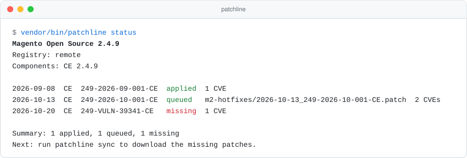
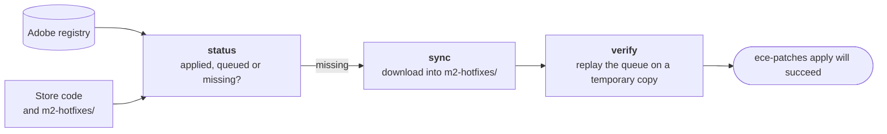

<div align="center">

<picture>
  <source media="(prefers-color-scheme: dark)" srcset="docs/logo-dark.svg">
  
</picture>

Finds the Adobe security patches a Magento Open Source store is missing and downloads them into `m2-hotfixes/`.

[](https://github.com/pushonltd/magento-patchline/actions/workflows/ci.yml)
[](https://packagist.org/packages/pushonltd/magento-patchline)
[](composer.json)
[](LICENSE)

<picture>
  <source media="(prefers-color-scheme: dark)" srcset="docs/status-dark.svg">
  
</picture>

</div>

---

Adobe publishes isolated security patches for Magento in a public registry,
[`repo.magento.com/patch/patch-registry.json`](https://repo.magento.com/patch/patch-registry.json), the same one
its own `patch-status` tool reads. Up to `magento/magento-cloud-patches` 1.1.18 these patches came with
`ece-patches apply`. Later versions no longer ship them for Open Source, so an Open Source store has to fetch them
itself.

Patchline checks the store against the registry, reports which patches are missing, and downloads them into
`m2-hotfixes/`. It does not apply them. `ece-patches apply` does that, as it does for any file in `m2-hotfixes/`.

> [!IMPORTANT]
> Patchline is an add-on to Adobe's [Quality Patches Tool](https://github.com/magento/quality-patches), not a
> replacement. It expects the store to install patches the way Adobe documents it:
> `composer require magento/quality-patches`, which brings `magento/magento-cloud-patches` and
> `vendor/bin/ece-patches`, and `ece-patches apply` on every build.

## How it fits with Adobe's patch tooling

`ece-patches apply` applies three sets of patches, in this order:

| # | Patches | Chosen by |
|---|---|---|
| 1 | Required patches bundled in `magento/magento-cloud-patches` | Adobe |
| 2 | Quality patches from `magento/quality-patches` listed in `QUALITY_PATCHES` | You |
| 3 | `m2-hotfixes/*.patch` | You, and Patchline for security patches |

Patchline only writes to step 3. Quality patches are Adobe's non-security fixes; you choose them and
`magento/quality-patches` supplies them, as before. Patchline does not track them, and `verify` does not replay them.

## What the commands do



- **`status`** lists every registry patch for the store's Magento version and whether it is already in the code,
  queued for `ece-patches apply`, or missing. Read-only.
- **`sync`** downloads the missing patches into `m2-hotfixes/`. It never overwrites a file and never touches `vendor/`.
- **`verify`** replays the queue on a temporary copy of the store, like a fresh deploy, and names the first patch
  that fails.

A fourth command, `rewind`, is a workaround for `ece-patches apply` itself: see
[Applying on every install](#recommended-wiring).

## Getting started

Requirements: Magento 2.4.6 or newer with [`magento/quality-patches`](https://github.com/magento/quality-patches)
installed, PHP 8.2+, a `patch` binary.

```bash
curl -fsSL https://github.com/pushonltd/magento-patchline/releases/latest/download/install.sh | bash
php patchline.phar status
php patchline.phar sync
php patchline.phar verify
```

Commit `m2-hotfixes/`. The next `ece-patches apply` applies the new patches.

The installer checks the PHAR's sha256, and its build provenance when `gh` is logged in. Pass
`--version=vX.Y.Z` (or `PATCHLINE_VERSION`) to pin a release and `--path=FILE` to install elsewhere:

```bash
curl -fsSL https://github.com/pushonltd/magento-patchline/releases/latest/download/install.sh | bash -s -- --version=vX.Y.Z --path=/usr/local/bin/patchline
```

The package is also on Packagist as `pushonltd/magento-patchline`, which you need for the next section.

## Recommended wiring

To apply the patches on every `composer install`, run `ece-patches apply` from the store's Composer scripts.
Stock `ece-patches apply` fails when `vendor/` already contains the patches, which happens on hosts and local setups
that keep `vendor/` between installs (DDEV, for example). `patchline rewind` reverses the queued patches first, so
`ece-patches apply` starts from clean code:

```bash
composer require pushonltd/magento-patchline   # not --dev: the scripts also run on install --no-dev
```

```json
"scripts": {
    "post-install-cmd": ["@apply-patches"],
    "post-update-cmd": ["@apply-patches"],
    "apply-patches": ["vendor/bin/patchline rewind", "vendor/bin/ece-patches apply"]
}
```

`rewind` is the only command that writes to `vendor/`:

- On a fresh `vendor/` it does nothing.
- It rehearses on a temporary copy first. If that fails, it changes nothing and exits 1. It works offline.
- It stops when a patch is applied in `vendor/` but missing from the queue, usually because a hotfix file was
  deleted. Run `sync` to restore it.
- Between `rewind` and `ece-patches apply`, `vendor/` is unpatched. Use it in a build step, never on a live docroot.

Don't put `status` in these scripts. It goes online and exits 1 whenever Adobe releases a new patch, which would
break `composer install`. Run it in CI instead.

## Running in CI

- **Daily:** `sync --adopt --prune`, and open a pull request if `m2-hotfixes/` changed. Adobe has no fixed release
  day.
- **On every pull request:** `status` and `verify`. `--format=github` adds annotations and a job summary; `junit`
  works with GitLab and Jenkins.

## Commands

```text
patchline status [options]
patchline sync [options]
patchline verify [options]
patchline rewind [--root=ROOT] [--dry-run]
```

### `status`

Lists every registry patch for the store's Magento version with its [state](#patch-states). Read-only.

### `sync`

Downloads missing patches as `m2-hotfixes/<released>_<id>.patch`. `ece-patches apply` applies `m2-hotfixes/` in
file name order, so the date prefix keeps patches in release order. Never overwrites a file, never touches `vendor/`.

### `verify`

Replays cloud-patches' required patches and `m2-hotfixes/` on a temporary copy of the store and names the first
patch that fails.

### `rewind`

Reverses the queued patches in `vendor/`, newest first, so `ece-patches apply` can run on it. See
[Recommended wiring](#recommended-wiring).

### Options

| Option | Commands | Meaning |
|---|---|---|
| `--root=ROOT` | all | Store root (default: current directory) |
| `--format=FORMAT` | all but `rewind` | `text`, `json`, `github` or `junit` (default `github` on GitHub Actions) |
| `--fail-on=FAIL-ON` | all but `rewind` | States that exit 1 (default `missing,duplicate,misordered`; also `cross-check`) |
| `--registry=REGISTRY` | all but `rewind` | Registry URL or file instead of repo.magento.com |
| `--cache-dir=CACHE-DIR` | all but `rewind` | Cache directory (default `<root>/var/patch_metadata`, shared with `patch-status`) |
| `--no-cache` | all but `rewind` | Don't use cached files |
| `--include-entitled` | all but `rewind` | Include Commerce-only patches (needs repo.magento.com keys) |
| `--cross-check` | all but `rewind` | Compare the result with `vendor/bin/patch-status` |
| `--no-update-check` | all but `rewind` | Don't check for a newer Patchline release |
| `--dry-run` | `sync`, `rewind` | Show the plan, change nothing |
| `--adopt` | `sync` | Rename hand-copied hotfix files to the dated naming |
| `--prune` | `sync` | Remove hotfix files that duplicate cloud-patches files |

## Patch states

| State | Meaning |
|---|---|
| `applied` | 🟢 Already in the code |
| `queued` | 🟢 Will be applied by `ece-patches apply` |
| `missing` | 🔴 Not in the code and not queued |
| `duplicate` | 🔴 Queued more than once, which makes `ece-patches apply` fail |
| `misordered` | 🔴 Queued before a patch it depends on |
| `entitled` | 🟡 Commerce-only, skipped without `--include-entitled` |
| `unknown` | 🟡 Could not be checked, e.g. locally modified files |
| `not_applicable` | ⚪ Only touches packages your store has removed |

🔴 states fail the run by default (see `--fail-on`).

A patch counts as `applied` when it dry-runs in reverse on a temporary copy of the code, the same check Adobe's
`patch-status` does.

## Exit codes

| Code | Meaning |
|---|---|
| 0 | All good |
| 1 | Needs action (see `--fail-on`), `sync` or `verify` failed, or `rewind` was blocked |
| 2 | Wrong usage |
| 3 | Could not run: no registry, no `patch` binary, unreadable store, or no `magento-cloud-patches` for `rewind` |

## Configuration

Every option also works as a `PATCHLINE_*` environment variable or under `extra.patchline` in the store's
`composer.json`. A flag wins over the environment, and the environment wins over `composer.json`.

```json
{ "extra": { "patchline": { "fail-on": ["missing", "duplicate"] } } }
```

repo.magento.com keys come from `COMPOSER_AUTH` or `auth.json` and are sent only to repo.magento.com. Set
`HTTPS_PROXY` to use a proxy.

## Network

Patchline downloads the registry and the patch files from repo.magento.com and checks each file against the sha256
in the registry. Adobe confirmed the registry is meant for public, automated use. The only other request is a daily
check of Packagist for a newer Patchline release; turn it off with `--no-update-check` or
`PATCHLINE_NO_UPDATE_CHECK=1`. `rewind` makes no requests.

Thanks to [@s-renz](https://github.com/s-renz) for finding the registry endpoint.

## Development

```bash
composer check      # code style, PHPStan level 10, tests
composer build      # dist/patchline.phar
composer mutation   # mutation tests
```

## Authors

- [PushON Ltd](https://www.pushon.co.uk/)
- Jiří Brada ([@jbrada](https://github.com/jbrada))

## License

MIT, © 2026 [PushON Ltd](https://www.pushon.co.uk/).
